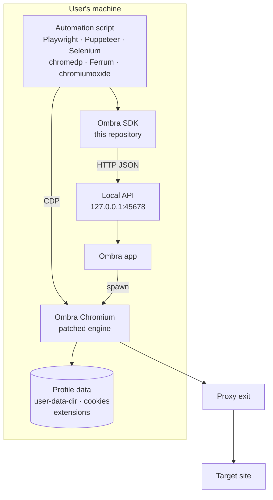
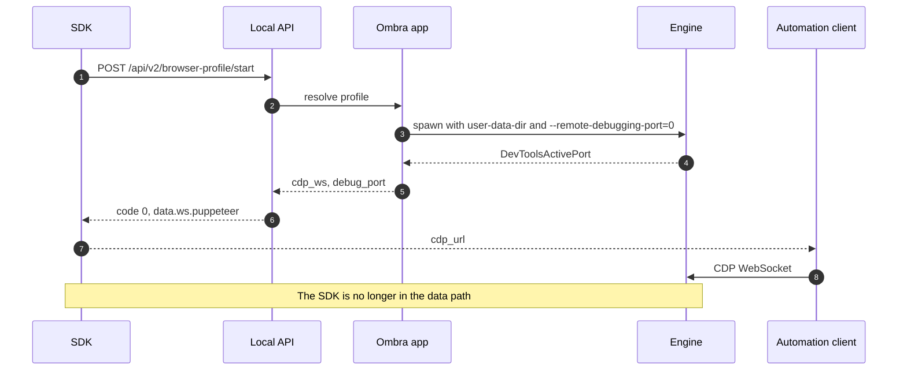

# Architecture

This repository is the SDK and contract layer of Ombra. It does not contain the browser engine or the app. Understanding that boundary is the point of this document. The product itself is described at [ombrabrowser.dev](https://ombrabrowser.dev).

## System context

The SDK and the automation client are peers. The SDK owns the profile lifecycle; the automation client owns the page. They meet at the CDP WebSocket returned by the Local API.

## Components

| Component | Repository | Responsibility |
|---|---|---|
| Ombra engine | `ombra-engine` | Chromium build, source-level fingerprint patches, humanized input, CAPTCHA module |
| Ombra app | separate repository | Hosts the Local API and starts and stops profiles. See [ombrabrowser.dev](https://ombrabrowser.dev). |
| SDKs | this repository | Typed Local API client, profile model, session model, CDP connection helper |
| Conformance | this repository | Language-neutral cases, fixtures, report schema |
| Contract | this repository | Wire mapping, error taxonomy, stealth invariants |
| Checkup | this repository | Stealth validation method and release gates |

## Launch sequence

Once the CDP connection is established, the SDK is not in the request path. It cannot add headers, rewrite traffic, inject scripts, or observe pages. That separation is deliberate: it keeps the SDK small and makes the browser's behavior independent of the language that started it.

## Why the SDK is thin

The alternative — a shared native core wrapped by eight languages — has real costs:

- A build matrix across macOS, Windows, and Linux for every language runtime.
- FFI boundaries that leak panics, threads, and memory semantics into managed runtimes.
- A second release cadence that must stay in lockstep with the engine.
- A larger attack surface on the user's machine.

A loopback JSON contract plus a WebSocket URL avoids all four. The SDK is a few source files per language, the app remains the only component that touches profiles and binaries, and the conformance suite can verify behavior over the wire instead of over FFI.

The trade-off is a hard dependency on the Ombra app. That dependency is intentional; the app is distributed separately at [ombrabrowser.dev](https://ombrabrowser.dev).

## Data and trust boundaries

| Boundary | Transport | Trust |
|---|---|---|
| SDK → Local API | Loopback HTTP | Local user; optional bearer key; browser `Origin` rejected |
| Local API → app | In-process | Same user; no network exposure |
| App → engine | Process spawn | App-controlled flags, profile directory, and license |
| Engine → target | Profile proxy | The only path to the network |
| SDK → CDP | Loopback WebSocket | Local user; same trust as any automation client |

The Local API is not a remote service. It binds to loopback and rejects requests that carry a browser `Origin`, which stops a random web page from driving the local app. SDKs must not proxy or re-expose it.

## Repository boundaries

- **This repository** owns the contract, SDK sources, conformance cases, and documentation. It publishes no engine binaries and stores no profile data.
- **The engine repository** owns patches, QA, builds, and release artifacts. It is the source of truth for fingerprint behavior.
- **The app** owns the Local API implementation and the profile lifecycle. It is the source of truth for wire behavior.
- **The docs site** owns user-facing guides. This repository owns developer-facing integration docs.

When a change crosses a boundary, the contract changes first, then the app or engine, then the SDKs. A SDK pull request that requires undocumented wire behavior is rejected.

## Failure modes

| Failure | Observed by SDK | Required behavior |
|---|---|---|
| App not running | Connection refused | `connection_failed` with the endpoint in the message |
| Wrong API key | `code: -1`, auth message | `unauthorized`; do not retry |
| Unknown profile | `code: -1`, profile message | `not_found` |
| Profile already running | Start waits or returns existing endpoint | Return a session, do not spawn a second browser |
| Engine missing | `code: -1`, engine message | `engine_unavailable`; suggest opening the app |
| Launch exceeds deadline | No response yet | `timeout`; tell the caller the profile may still start and must be stopped |
| Local API restarts | Connection reset | No automatic relaunch; caller decides |
| CDP disconnects | Automation client error | SDK does not reconnect; the session may still be alive |
| Stop called twice | `code: 0` | Succeed |

The SDK never leaves an orphaned session silently. If launch times out, the error carries the profile ID so the caller can call `stop`.

## Evolution

The contract is versioned independently. The intended path:

1. `0.1` — lifecycle, profiles, humanize, CAPTCHA settings, CDP helpers.
2. `0.2` — groups and proxies, typed CAPTCHA events, session adoption, richer pagination.
3. `1.0` — frozen wire mapping, compatibility guarantees, deprecation policy.

Engine changes do not require SDK releases unless the wire changes. That is the main reason to keep this layer thin.

See [sdk-contract.md](sdk-contract.md) for the normative details and [versioning.md](versioning.md) for compatibility rules.
