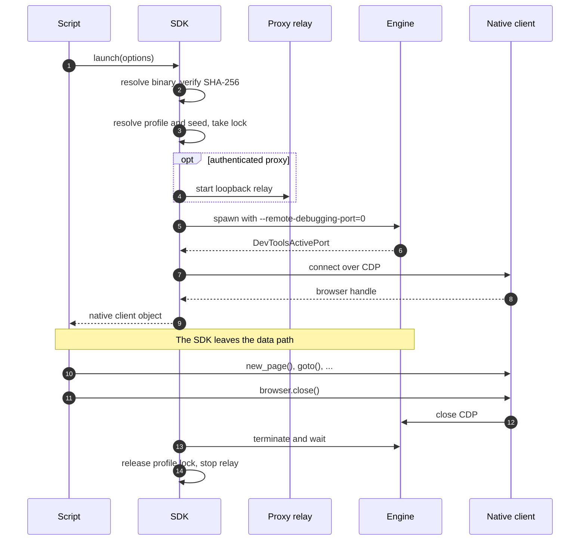

# Architecture

This repository is the SDK layer of Ombra. It launches the patched engine, connects a native automation client over CDP, and gets out of the way. It does not contain the engine and does not depend on the Ombra app.

The product itself is described at [ombrabrowser.dev](https://ombrabrowser.dev).

## System context

```mermaid
flowchart TB
    subgraph Machine["User's machine"]
        Script["Automation script"]
        SDK["Ombra SDK<br/>binary resolution · launch · CDP bridge"]
        Engine["Ombra Chromium<br/>patched engine"]
        Client["Playwright · Puppeteer<br/>chromedp · Ferrum · chromiumoxide"]
        Profile[("Profile<br/>seed · cookies · storage")]
        Relay["Loopback proxy relay<br/>optional"]
    end

    Proxy["Proxy exit"]
    Site["Target site"]

    Script -->|launch()| SDK
    SDK -->|spawn| Engine
    SDK -->|connect| Client
    Script -->|page API| Client
    Client -->|CDP| Engine
    SDK -.->|authenticated proxy| Relay
    Relay --> Proxy
    Engine --> Profile
    Engine --> Proxy
    Proxy --> Site
```

The SDK is a process manager and a CDP bridge. The automation client is the page API. The engine is the browser. There is no HTTP control plane between the script and the browser.

## Components

| Component | Repository | Responsibility |
|---|---|---|
| Ombra engine | `ombra-engine` | Chromium build, source-level fingerprint patches, humanized input, CAPTCHA module |
| SDKs | this repository | Binary resolution and verification, process lifecycle, profiles, proxy relay, CDP connection, typed errors |
| Automation clients | upstream | Playwright, Puppeteer, chromedp, Ferrum, chromiumoxide; page API and CDP transport |
| Conformance | this repository | Language-neutral launch and stealth cases, report schema |
| Contract | this repository | Launch options, return types, error taxonomy, stealth invariants |
| Checkup | this repository | Stealth validation method and release gates |

The Ombra app is a separate product for manual profile management. It is not a dependency, not a control plane, and not in the launch path.

## Launch sequence



The returned object is the client's own type: a Playwright or Puppeteer browser, a chromedp session, a Ferrum browser, or a chromiumoxide browser. The SDK does not proxy its methods or interpose on page calls.

## Why not a control-plane service

A control-plane API is useful for an application that owns profiles and a user interface. It is the wrong seam for an automation library:

- It adds a running service and a second process to every script, container, and CI job.
- It forces the SDK to model a product surface that has nothing to do with Playwright or Puppeteer.
- It creates a network hop and an authentication surface that the browser does not need.
- It makes the SDK version track the app, not the engine.

The SDK instead speaks the protocol the browser already exposes: CDP. Process lifecycle is local, the debug port is loopback, and the automation client connects directly. The app remains available for users who want a GUI; it is simply not part of this path.

## Why the SDK is thin

The alternative — a shared native core wrapped by eight languages — has real costs:

- A build matrix across macOS, Windows, and Linux for every language runtime.
- FFI boundaries that leak panics, threads, and memory semantics into managed runtimes.
- A second release cadence that must stay in lockstep with the engine.
- A larger attack surface on the user's machine.

A launcher plus a CDP URL avoids all four. The SDK is a few source files per language, the engine remains the only component that touches fingerprints, and the conformance suite verifies launch behavior instead of FFI behavior.

The trade-off is a hard dependency on the engine binary. That dependency is intentional: Ombra is a browser, not a driver.

## Data and trust boundaries

| Boundary | Transport | Trust |
|---|---|---|
| SDK → engine | process spawn | Local user; binary is checksum-verified before spawn |
| SDK → automation client | in-process | Same user; no network |
| Client → engine | loopback CDP | Local user; the debug port is not exposed |
| Engine → target | profile proxy | The only path to the network |
| SDK → proxy relay | loopback socket | Credentials in memory; not in the process command line |

The engine process inherits only the environment the SDK passes. Proxy credentials, license keys, and profile data must not leak into logs, crash reports, or the command line.

## Binary lifecycle

1. **Resolve.** Explicit path, environment, app-installed engine, managed cache, download.
2. **Verify.** SHA-256, platform, architecture, executable permission, quarantine attributes.
3. **Launch.** Spawn with a loopback debug port and the resolved profile.
4. **Update.** Optional, version-aware, and never in the middle of a launch.
5. **Clean up.** Terminate the process tree on close, timeout, or crash.

The SDK never modifies an engine binary in place. A new version lands in a new cache directory; rollback is a version pin.

## Repository boundaries

- **This repository** owns the launch contract, SDK sources, conformance cases, local desktop catalog, shared controls and their documentation. It publishes no engine binaries and stores no profile data.
- **The engine repository** owns patches, QA, builds, and release artifacts. It is the source of truth for fingerprint behavior.
- **The legacy Desktop repository** holds the complete 1.2.1 GUI and its runtime integrations. Development of the independent local profile components is tracked here. [Desktop source](../desktop/README.md).
- **The docs site** owns user-facing product guides. This repository owns developer-facing integration docs.

When a change crosses a boundary, the contract changes first, then the engine or SDK, then the docs. An SDK pull request that depends on undocumented engine flags is rejected.

## Failure modes

| Failure | Observed by SDK | Required behavior |
|---|---|---|
| No binary | Resolution returns nothing | `BinaryNotFound`; mention `ensure_binary()` |
| Checksum mismatch | Hash differs | `ChecksumMismatch`; do not launch |
| Wrong platform | No build for host | `UnsupportedPlatform` |
| License refused | Engine exits early or prints a license error | `LicenseError` with the engine message |
| Proxy relay failed | Port bind or connect error | `ProxyError` before spawn |
| Profile already open | Lock held by a live process | `ProfileBusy`; do not steal the lock |
| CDP endpoint missing | `DevToolsActivePort` does not appear | `LaunchTimeout`; terminate the process |
| CDP refused | Endpoint exists, connect fails | `CDPConnectError`; terminate the process |
| Engine exits during launch | Process exit code | `EngineExited` with the stderr tail |
| Engine crashes later | Client disconnect | `EngineCrashed` if the SDK observes it; otherwise the client reports it |

Launch is never retried automatically. A retry creates a second browser, a second profile lock, and a second chance to leave an orphan.

## Evolution

1. `0.1` — launch, profiles, seed, proxy relay, binary verification, CDP bridge for Playwright/Puppeteer.
2. `0.2` — richer profile metadata, Puppeteer parity, more native clients.
3. `1.0` — frozen option schema, compatibility guarantees, deprecation policy.

Engine changes do not require SDK releases unless a launch option or flag changes. That is the main reason to keep this layer thin.

See [sdk-contract.md](sdk-contract.md) for the normative details and [versioning.md](versioning.md) for compatibility rules.
